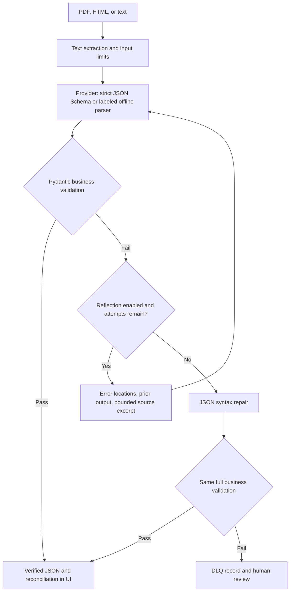

# SchemaExtractor

A Python 3.11+ invoice extraction application with a Streamlit UI, native OpenAI
Structured Outputs, Pydantic v2 business rules, bounded reflection, JSON syntax
repair, and a private on-disk dead-letter queue.

**Start with [START_HERE.md](START_HERE.md).** The offline demo works without an
API key. It is a template parser for the sample invoice format, not an LLM.
Use OpenAI mode to demonstrate real constrained AI extraction.

## Architecture and data flow



The provider wire schema enforces required keys and types, with `strict: true`
and `additionalProperties: false` in nested objects. Money and dates travel as
strings. `InvoiceExtraction` then enforces richer domain constraints. This keeps
provider schema compatibility separate from deterministic business validation.
JSON mode alone is not considered grammar-constrained extraction.

## Installation

Install Python 3.11+ and [uv](https://docs.astral.sh/uv/getting-started/installation/).
From the extracted project folder, in PowerShell:

```powershell
uv sync --frozen
Copy-Item .env.example .env
uv run streamlit run src/app.py
```

Open http://localhost:8501. Select **Offline demo** for the included samples.
For arbitrary invoice layouts select **OpenAI Structured Outputs** and set
`OPENAI_API_KEY` in `.env`, or enter a key in the password input. A ChatGPT
subscription does not supply API credit. Never commit `.env` or real documents.
`OPENAI_MODEL` defaults to `gpt-4o-mini`; use a model supporting strict Structured
Outputs and available to your API account. A model/key/quota error is reported
and routed to DLQ rather than silently switching to fake success.

## Run and test

```powershell
uv run streamlit run src/app.py
uv run pytest -v
```

Run commands from this folder. `uv.lock` records tested dependency versions.
`pytest` is included in the project dependencies so the same environment can
run the required terminal demonstration.

## Data contract

| Field | Type | Rules |
| --- | --- | --- |
| invoice_number | string | 1–64 characters; letters/numbers followed by letters/numbers or `._/-` |
| vendor_name | string | Nonblank, at most 200 characters |
| invoice_date | date | ISO date or documented month-name date; ambiguous numeric dates rejected |
| line_items | list of LineItem | 1–200 entries |
| description | string | Nonblank, at most 300 characters |
| quantity | strict integer | 1–1,000,000; no booleans or numeric strings |
| unit_price | Decimal | Positive, at most 1 billion, at most two decimal places |
| line_total | Decimal | Nonnegative; quantity × unit_price within 0.02 |
| subtotal, tax_amount, total_amount | Decimal | Finite, nonnegative, at most 1 billion, two decimal places |
| currency | enum | USD, EUR, GBP |

All objects reject unknown fields. Decimal arithmetic avoids binary float
reconciliation errors. Accepted examples: `$1,249.50`, `GBP 12.00`,
`12th of Oct, 2024`, and `2024-10-12`. Decimal-comma amounts and ambiguous dates
such as `10/12/2024` are rejected rather than guessed. JSON downloads serialize
money as exact decimal strings.

Three invoice invariants use an **inclusive 0.02** tolerance:
1. Sum of line totals equals subtotal.
2. Subtotal plus tax equals total.
3. Sum of line totals plus tax equals total.

Each line independently reconciles quantity × unit price with its line total.
A truly contradictory invoice is sent for review; the app must not invent new
source values merely to make the math pass.

## Retry and fallback contract

- `max_retries=3` means **at most three total adapter calls**, including the first.
- Reflection disabled: a validation failure goes straight to syntax repair.
  Transient transport errors may still retry within the total call budget.
- SDK retries are disabled; backoff is 0.5, 1, 2… seconds, capped at 4 seconds.
- Exact validation locations/messages and previous responses appear in the audit.
- Each reflection includes at most 6,000 source characters plus an omission marker,
  at most 8,000 prior-response characters, and the first 20 validation errors.
  It uses the beginning and end of a long document; no accumulating chat history.
- Syntax repair is followed by full validation. No partial invoices count as success.
- Statuses: `SUCCESS`, `REPAIRED_VIA_REFLECTION`, `REPAIRED_HEURISTIC`, `DLQ_FAILED`.
- API refusal, invalid key and other permanent provider failures stop immediately.
  Network/timeouts, HTTP 429, and HTTP 5xx retry within the budget.
- DLQ files contain source text, SHA-256, final payload and audit metadata in
  `dlq/`. Each has a unique name and restrictive POSIX permissions. If disk writing
  fails, the UI exposes the storage error and lets you download the audit.

## Demonstration controls

| Control | Expected outcome on the normal sample |
| --- | --- |
| Extract & validate | First-attempt success |
| Simulate reflection recovery | Deletes currency after the first adapter response; attempt 2 recovers with reflection enabled |
| Simulate Edge Case Failure | Injected irrecoverable output; DLQ after the configured attempts |
| Simulate JSON syntax repair | Adds trailing comma; bypasses reflection for this run to show heuristic repair |
| invoice_inconsistent.txt | Actual source contradiction; should remain failed |

Fault injection is visibly labeled. In OpenAI mode the reflection simulation
modifies the first real provider response; hard-failure injection skips network
calls entirely. Offline simulations prove pipeline control flow, not an LLM's
ability to reason. Real AI behavior must be shown separately for the assignment.

## AI audit log summary

See [ai_prompt_log.md](ai_prompt_log.md) for the actual user instruction,
attachment-derived design brief, retained naive audit specimen, and the exact
code/test references. The specimen illustrates missing business checks and
unbounded retry context; regression tests demonstrate why the final code rejects
those behaviors. It is explicitly an AI-authored teaching specimen, not a record
of student work or fabricated revisions.

## Container demo / deployment

A local container demo is the assignment's alternative to cloud hosting:

```powershell
docker compose up --build
# Separate terminal, from the same folder:
docker compose exec extractor python -m pytest -v
# After recording:
docker compose down
```

Browse http://localhost:8501. Compose forwards only localhost, reads API variables
from the local `.env`, and persists DLQ records in a named volume. `docker compose
down -v` deletes that volume; use it only after retaining anything needed for
review. The Docker image runs as a non-root user. Docker was not available in the
build environment, so the container build/run remains to be verified locally.

For Streamlit Community Cloud, push your own repository and configure
`src/app.py` as the entry point; set `OPENAI_API_KEY` and `OPENAI_MODEL` through
hosting secrets. `requirements.txt` is provided for pip-based hosts. A hosted
single-process filesystem can be ephemeral; use durable private storage for a
real production DLQ. Do not expose confidential invoices in a public demo.

## Scope and limits

This is an assignment-ready implementation, not a deployed enterprise service.
No authentication, OCR, queue worker, database integration, or cloud deployment
is claimed. Text PDFs only (maximum 10 MB, 30 pages, 60,000 characters). Supported
invoices contain one currency and no separate shipping/discount calculation.
`vendor_contract.html` is an invoice attachment, not a general contract-extraction
schema. Real provider extraction may be semantically wrong even if its types and
math validate: those checks cannot prove source fidelity. Long-document retries
may omit relevant evidence; fail to human review when correction cannot be grounded.

## Validation evidence

See [QA_REPORT.md](QA_REPORT.md) for completed checks and unverified integration
steps. [VIDEO_GUIDE.md](VIDEO_GUIDE.md) maps the rubric to a six-minute walkthrough.
[SUBMISSION_TEMPLATE.md](SUBMISSION_TEMPLATE.md) keeps uncreated URLs blank.

## Primary documentation

- [OpenAI Structured Outputs](https://developers.openai.com/api/docs/guides/structured-outputs)
- [Pydantic v2 validators](https://docs.pydantic.dev/latest/concepts/validators/)
- [Streamlit testing](https://docs.streamlit.io/develop/api-reference/app-testing)
